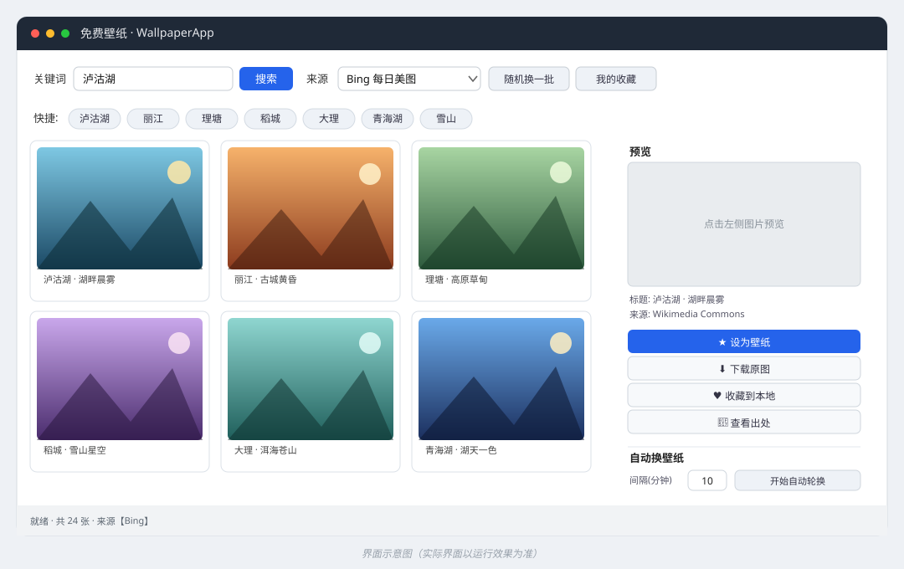

# 🖼️ WallpaperApp — Free & Open-Source Wallpaper App

<p align="center">
  
</p>

<p align="center">
  <a href="README.md">中文</a> · <b>English</b>
</p>

<p align="center">
  <a href="https://github.com/bdvyr26p8g-boop/wallpaper-app/releases/latest/download/WallpaperApp.exe">
    
  </a>
</p>

<p align="center">
  <sub>Windows 10/11 x64 · single portable file · double-click to run, no Python needed</sub>
</p>

> A completely free, open-source Windows desktop wallpaper app with **no paid API keys required**.
> It fetches beautiful photos in real time from public sources (Lugu Lake, Lijiang, Litang, Daocheng, snow mountains, ancient towns…), sets them as your desktop wallpaper in one click, and supports favorites plus scheduled rotation.


---

## ✨ Features

- 🔥 **Unified search (default)**: one query fans out to **360 Images, Bing Images, Baidu Images, Wikimedia and Openverse** in parallel, merges + dedupes the results and sorts them by resolution — typically **80–150 wallpapers per search**, with a "Load more" button for extra pages.
- 🖼️ **True high-resolution originals**: 360 / Bing hand back direct original-image URLs (tested at 5000×3300, ~1.8 MB). Every thumbnail shows its real resolution; green means ≥1600 px.
- 🆓 **Free, no sign-up**: all sources are public, key-free endpoints. No paid quota, no API key.
- 🔍 **Place / keyword search**: built-in quick tags (Lugu Lake, Lijiang, Daocheng Yading, Shangri-La, Jiuzhaigou, Zhangjiajie, Guilin, Potala Palace…) or type your own. Chinese place names work far better than with Western stock libraries.
- 🖼️ **4-column thumbnail grid**: multi-threaded async loading; 500 px previews (30–90 KB each) keep scrolling smooth.
- ⚡ **One-click wallpaper**: downloads the original image and sets it as your Windows desktop wallpaper.
- ⬇️ **Download original / ♥ Favorite**: favorites are stored locally under `Pictures/WallpaperApp/favorites`.
- 🔄 **Scheduled rotation**: change wallpaper automatically every 1–120 minutes.
- 💾 **Persistence**: favorites, last source/keyword and rotation interval are saved.
- 🧩 **Pure Python stdlib + optional Pillow**: minimal dependencies, just double-click to run.

## 📸 Screenshot

<p align="center">
  
</p>

> The image above is a UI mockup. The actual interface may differ. Feel free to submit real screenshots to `docs/`.

## 🚀 Quick Start

### Option 0: Use the prebuilt exe (no install, recommended)

No Python needed — just download and double-click **`WallpaperApp.exe`**:

- Grab it from [Releases](https://github.com/bdvyr26p8g-boop/wallpaper-app/releases);
- Double-click, type a keyword (e.g. "Lugu Lake") → **Search** → click an image → **★ Set as wallpaper**;
- To rotate automatically, set the **interval (minutes)** and click **▶ Start rotation**.

> If Windows SmartScreen or antivirus warns you, that's because the unsigned single-file exe is a common PyInstaller false positive — choose "More info → Run anyway".

### Requirements (running from source)

- Windows 10 / 11
- Python 3.8+ (tick **Add Python to PATH** during installation)
- Optional: Pillow (for thumbnails; `run.bat` will try to install it automatically)

### Option 1: Double-click (recommended)

Double-click **`run.bat`**. It will:

1. Detect and try to install Pillow;
2. Start the app with `py -3` or `python`.

### Option 2: Command line

```bat
:: Install dependency (only needed for thumbnails)
python -m pip install pillow

:: Run
python app.py
```

### Option 3: Build your own exe

Double-click **`build_exe.bat`**, or run:

```bat
python -m pip install pillow pyinstaller
python -m PyInstaller --onefile --windowed --name WallpaperApp --icon assets/app.ico app.py
```

The output is `dist\WallpaperApp.exe` — a single portable file you can share with people who don't have Python.

## 🖱️ Usage

1. **Type a keyword / place name** in the top box (e.g. "Lugu Lake", "Daocheng Yading") or click a quick tag, then click **🔍 Search**.
   **No source selection needed** — the app queries 360 / Bing / Baidu / Wikimedia / Openverse in parallel, merges and dedupes the results, typically 80–150 wallpapers per search.
2. Click **＋ Load more** to fetch another page.
3. Click a thumbnail on the left to preview it on the right; the small caption shows the **real resolution** (e.g. `5184×3456`, green = ≥1600 px HD).
4. **★ Set as wallpaper** applies it immediately; **⬇ Download original** saves it; **♥ Favorite** adds it to your collection; **🔗 View source** opens the original page.
5. Set the **interval (minutes)** and click **▶ Start rotation** to change wallpaper automatically (closing the window offers "minimize and keep rotating").
6. **♥ Browse favorites** shows your collection in the grid; **📁 Favorites folder** opens it in Explorer.

## 🗂️ Project Structure

| File | Purpose |
|------|---------|
| `app.py` | GUI main program (tkinter) — UI and interaction |
| `sources.py` | Source adapters (360 Images / Bing Images / Baidu Images / Wikimedia / Openverse / Bing Daily / Picsum) + unified-search aggregation |
| `wallpaper_core.py` | Image download with cache, Windows wallpaper setting, cache/favorites dirs |
| `run.bat` | One-click launcher for Windows |
| `build_exe.bat` | Build a single-file exe (PyInstaller) |
| `assets/app.ico` | App icon |
| `docs/` | Banner and UI mockup |
| `.github/workflows/ci.yml` | CI: syntax, import and SVG checks |
| `requirements.txt` | Dependencies (Pillow) |
| `settings.json` / `favorites.json` | User settings & favorites (generated at runtime, git-ignored) |

Cache: `%USERPROFILE%\Pictures\WallpaperApp\cache`
Favorites: `%USERPROFILE%\Pictures\WallpaperApp\favorites`

## 🌐 Sources & Licensing

| Source | Key required | Quality | Notes |
|--------|--------------|---------|-------|
| **360 Images** | No | ⭐⭐⭐ originals (5000×3300+ tested) | Best hit rate for Chinese place names, 1000+ results per keyword; the workhorse of unified search |
| **Bing Images** | No | ⭐⭐⭐ originals | Large-image filter applied; results often come from Ctrip, Qunar, Mafengwo, Sina Travel |
| **Baidu Images** | No | ⭐ 500 px standard | Highest hit rate, but Baidu caps direct links at 500 px, so it is labelled "SD" and only fills gaps |
| **Wikimedia Commons** | No | ⭐⭐⭐ originals | Queried with both Chinese name and English alias; mostly Creative Commons |
| **Openverse** | No | ⭐⭐ | Aggregates Creative Commons images, keyword search |
| **Bing Daily** | No | ⭐⭐⭐ 1920×1080 | Microsoft's daily homepage image, with copyright notice |
| **Picsum (Lorem Picsum)** | No | ⭐⭐⭐ 1920×1080 | Random high-quality photos (from Unsplash etc.) |

### A note on travel-site images

Mafengwo, Ctrip and Qunar aggressively block scraping (they return HTTP 202 or JS-only pages), so this app
does not bypass them. However, **Bing Images and 360 Images already surface plenty of images hosted on those
travel sites** — click **🔗 View source** and you will see `qunarzz.com`, `c-ctrip.com`, `mafengwo.cn`.
In practice this is equivalent to "getting pictures from travel websites".

> All images belong to their original authors. This app only provides search and download capabilities; **downloaded content is for personal desktop use only**. For public sharing or commercial use, follow the license of the corresponding source and verify it via **🔗 View source** in the app.

## ❓ FAQ

- **Thumbnails don't show / "Pillow not detected"?**
  Run `python -m pip install pillow` and restart.

- **"Set as wallpaper" does nothing?**
  Make sure you're on Windows; some "wallpaper-protection" security tools may block the system call — allow it.

- **A source fails to load?**
  Your network may not reach that site (Wikimedia / Openverse can be restricted on some networks). The app is fault-tolerant — one failing source won't break the others, and the status bar lists the failing ones.

- **No results for a place name?**
  Make sure **🔥 Unified search** is selected, and prefer common spellings ("Lijiang Old Town", "Daocheng Yading").

- **"Access denied" or very few images?**
  360 / Baidu rate-limit bursty requests. The app throttles at 0.8–0.9 s between calls and retries automatically; if you are still limited, wait 1–2 minutes.

- **Why is Baidu standard-definition?**
  Baidu caps its direct image links at 500 px. It is kept as a high-hit-rate fallback, while 360 / Bing supply the HD originals.

## 🤝 Contributing

Issues and PRs are welcome! You can:

- Add more free sources (NASA, Unsplash official API, …);
- Add resolution filtering (4K only), system tray, launch-on-startup;
- Improve UI, docs or screenshots.

Please make sure the code runs correctly and stays consistent. See [CONTRIBUTING.md](CONTRIBUTING.md).

## 📄 License

Released under the [MIT License](LICENSE). Free to use, modify and distribute.
