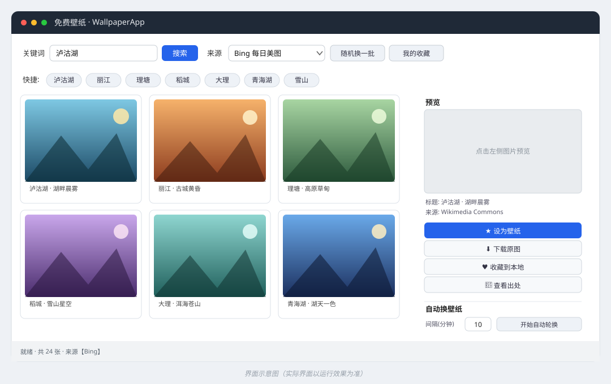

# 🖼️ 免费壁纸 · WallpaperApp

<p align="center">
  
</p>

<p align="center">
  <b>中文</b> · <a href="README.en.md">English</a>
</p>

<p align="center">
  <a href="https://github.com/bdvyr26p8g-boop/wallpaper-app/releases/latest/download/WallpaperApp.exe">
    
  </a>
</p>

<p align="center">
  <sub>Windows 10/11 x64 · 单文件免安装 · 双击即用，无需 Python</sub>
</p>

> 一个完全免费、开源、无需任何付费 API Key 的 Windows 桌面壁纸软件。
> 实时从公开免费图源获取美图（泸沽湖、丽江、理塘、稻城、雪山、古镇……），一键设为桌面壁纸，支持收藏与定时自动轮换。


---

## ✨ 功能特性

- 🔥 **综合搜索（默认）**：一次搜索并发抓取 **360 图片、Bing 图片、百度图片、Wikimedia、Openverse** 五个源，合并去重后按分辨率排序，单次可得 **80–150 张**，点「＋ 加载更多」还能继续翻页。
- 🖼️ **真·高清原图**：360 / Bing 源直接给原图直链（实测 5000×3300、1.8MB 级别），每张缩略图角落标注真实分辨率，绿色代表 ≥1600px 高清。
- 🆓 **完全免费、无需注册**：全部为公开网页接口，不需要任何 API Key、不消耗付费额度。
- 🔍 **地名 / 关键词搜索**：内置快捷标签（泸沽湖、丽江、稻城亚丁、香格里拉、九寨沟、张家界、桂林、布达拉宫……），也可自由输入关键词，中文地名命中率远高于国外图库。
- 🖼️ **4 列缩略图网格**：多线程异步加载，500px 小图做预览（每张仅 30–90KB），滚动流畅不卡界面。
- ⚡ **一键设壁纸**：自动下载原图并设置为 Windows 桌面壁纸。
- ⬇️ **下载原图 / ♥ 收藏**：收藏保存在本地 `图片/WallpaperApp/favorites`，随时打开使用。
- 🔄 **定时自动轮换**：可设置 1–120 分钟间隔，后台自动换壁纸，壁纸常换常新。
- 💾 **本地持久化**：收藏、上次来源与关键词、自动轮换间隔都会保存。
- 🧩 **纯 Python 标准库 + 可选 Pillow**：依赖极少，双击即可运行。

## 📸 界面

启动后顶部只有一个关键词输入框（无需选图源），左侧是 4 列缩略图网格，右侧是预览与操作面板。

<p align="center">
  
</p>

> 上图是界面示意图，实际界面以运行效果为准。欢迎把你的真实截图提交到 `docs/` 并在本节展示。

## 🚀 快速开始

### 方式零：直接使用 exe（免安装，推荐普通用户）

无需安装 Python，直接下载并双击 **`WallpaperApp.exe`** 即可使用：

- 到 [Releases](https://github.com/bdvyr26p8g-boop/wallpaper-app/releases) 下载 `WallpaperApp.exe`；
- 双击运行，选择来源、点选关键词（如「泸沽湖」）→「搜索」→ 点图片 →「★ 设为壁纸」；
- 需要自动换桌面时，在右侧设置「间隔(分钟)」后点「▶ 开始自动轮换」。

> 首次运行若被 Windows SmartScreen 或杀毒软件提示，是因为单文件 exe 未签名（PyInstaller 打包常见误报），选择「更多信息 → 仍要运行」或加入信任即可。

### 环境要求（源码运行）

- Windows 10 / 11
- Python 3.8+（安装时勾选 **Add Python to PATH**）
- 可选：Pillow（用于显示缩略图，`run.bat` 会自动尝试安装）

### 方式一：双击启动（源码，推荐开发者）

直接双击 **`run.bat`**。脚本会自动：

1. 检测并尝试安装 Pillow；
2. 用 `py -3` 或 `python` 启动程序。

### 方式二：命令行

```bat
:: 安装依赖（仅缩略图显示需要）
python -m pip install pillow

:: 启动
python app.py
```

### 方式三：自行打包 exe

双击 **`build_exe.bat`**，或手动执行：

```bat
python -m pip install pillow pyinstaller
python -m PyInstaller --onefile --windowed --name WallpaperApp --icon assets/app.ico app.py
```

产物位于 `dist\WallpaperApp.exe`，单文件、双击即用，可分发给没装 Python 的人。

## 🖱️ 使用说明

1. **在顶部输入框输入关键词 / 地名**（如"泸沽湖""稻城亚丁"），或直接点下面的快捷标签，然后点「🔍 搜索」。
   **不需要选择图源**——程序会自动同时查询 360 / Bing / 百度 / Wikimedia / Openverse 并合并去重，一次通常 80–150 张。
2. 图不够就点「**＋ 加载更多**」继续翻页。
3. 左侧点击缩略图，右侧即可预览；缩略图下方小字是**真实分辨率**（如 `5184×3456`，绿色代表 ≥1600px 高清）。
4. 点「★ 设为壁纸」立即换桌面；「⬇ 下载原图」保存到本地；「♥ 收藏到本地」加入收藏夹；「🔗 查看出处」打开原网页核对版权。
5. 设置「间隔(分钟)」后点「▶ 开始自动轮换」，即可定时自动换壁纸（关闭窗口时会问是否最小化继续）。
6. 「♥ 浏览收藏」在网格里回看已收藏的图；「📁 收藏目录」直接打开收藏所在文件夹。

## 🗂️ 项目结构

| 文件 | 作用 |
|------|------|
| `app.py` | GUI 主程序（tkinter），负责界面与交互 |
| `sources.py` | 图源适配器（360 图片 / Bing 图片 / 百度图片 / Wikimedia / Openverse / Bing 每日 / Picsum）+ 综合搜索聚合 |
| `wallpaper_core.py` | 图片下载（带缓存）、Windows 设壁纸、缓存/收藏目录管理 |
| `run.bat` | Windows 一键启动脚本 |
| `build_exe.bat` | 一键打包单文件 exe（PyInstaller） |
| `assets/app.ico` | 程序图标 |
| `docs/` | Banner 与界面示意图 |
| `.github/workflows/ci.yml` | CI：语法、导入、SVG 合法性检查 |
| `requirements.txt` | 依赖清单（Pillow） |
| `settings.json` / `favorites.json` | 用户设置与收藏（运行时自动生成，已加入 .gitignore） |

图片缓存：`%USERPROFILE%\Pictures\WallpaperApp\cache`
收藏图片：`%USERPROFILE%\Pictures\WallpaperApp\favorites`

## 🌐 图源与版权说明

| 图源 | 需要 Key | 画质 | 说明 |
|------|----------|------|------|
| **360 图片** | 否 | ⭐⭐⭐ 原图（实测 5000×3300+） | 中文地名命中率最高，单关键词总量上千张，是「综合搜索」的主力 |
| **Bing 图片** | 否 | ⭐⭐⭐ 原图 | 仅取大图，结果常来自携程、去哪儿、马蜂窝、新浪等旅游/资讯站 |
| **百度图片** | 否 | ⭐ 标清 500px | 命中率最高，但百度对直链做了 500px 限流，故标注为「标清」，仅在高清不足时补位 |
| **Wikimedia Commons** | 否 | ⭐⭐⭐ 原图 | 中文名 + 英文别名双关键词检索，多为知识共享（CC）授权，适合风景与人文 |
| **Openverse** | 否 | ⭐⭐ | 聚合 Creative Commons 授权图片，按关键词搜索 |
| **Bing 每日美图** | 否 | ⭐⭐⭐ 1920×1080 | 微软每日首页图，含中文版权说明，适合做桌面 |
| **Picsum (Lorem Picsum)** | 否 | ⭐⭐⭐ 1920×1080 | 随机高质量摄影图（来自 Unsplash 等） |

### 关于「旅游网站的图片」

马蜂窝、携程、去哪儿等站点对直接抓取有较强反爬（返回 202 或 JS 页面），本软件不硬破解它们；
但 **Bing 图片 与 360 图片 的检索结果本身就大量来自这些旅游站点**（可在软件里点「🔗 查看出处」看到
`qunarzz.com`、`c-ctrip.com`、`mafengwo.cn` 等来源），因此效果上等同于"从旅游网站取图"。

> 图片版权归原作者所有。本软件仅提供检索与下载能力，**下载内容仅供个人桌面使用**；如需公开传播或商用，请遵守对应图源的授权协议，并点击软件内「🔗 查看出处」核实来源。

## ❓ 常见问题

- **缩略图不显示 / 提示未检测到 Pillow？**
  运行 `python -m pip install pillow` 后重启程序。

- **点击「设为壁纸」没有反应？**
  确认在 Windows 上运行；部分"防壁纸修改"类安全软件会拦截系统调用，请放行。

- **某个图源加载失败？**
  可能是当前网络访问不到该站点（如 Wikimedia / Openverse 在部分网络下受限）。软件已做容错，单个源失败不影响其它源，状态栏会列出异常源。

- **搜索地名没结果？**
  先确认用的是「🔥 综合搜索」；再检查关键词是否过于生僻（可换成"丽江古城""稻城亚丁"这类常见写法）。

- **提示"访问异常"或图片很少？**
  360 / 百度 对高频请求有风控，程序已内置 0.8–0.9 秒节流与自动重试；如果短时间内反复搜索仍被限流，等 1–2 分钟再搜。

- **百度图片为什么是标清？**
  百度把图片直链限制为 500px，无法在不破解其加密参数的前提下取原图。所以本软件把百度作为"命中率高但画质一般"的兜底源，高清优先用 360 / Bing。

## 🤝 参与贡献

欢迎 Issue 与 PR！你可以：

- 新增更多免费图源（如 NASA、Unsplash 官方 API 等）；
- 增加「仅 4K / 按分辨率筛选」「托盘常驻」「开机自启」等能力；
- 优化 UI 或补充文档、截图。

提交前请确保代码可正常运行，并保持风格一致。详见 [CONTRIBUTING.md](CONTRIBUTING.md)。

## 📄 开源协议

本项目基于 [MIT License](LICENSE) 开源，可自由使用、修改与分发。
